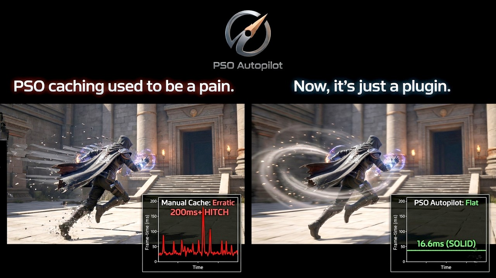
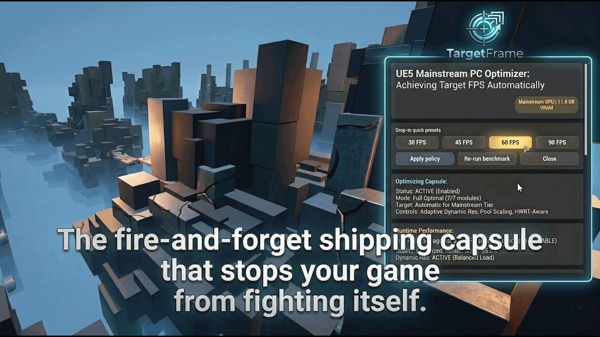
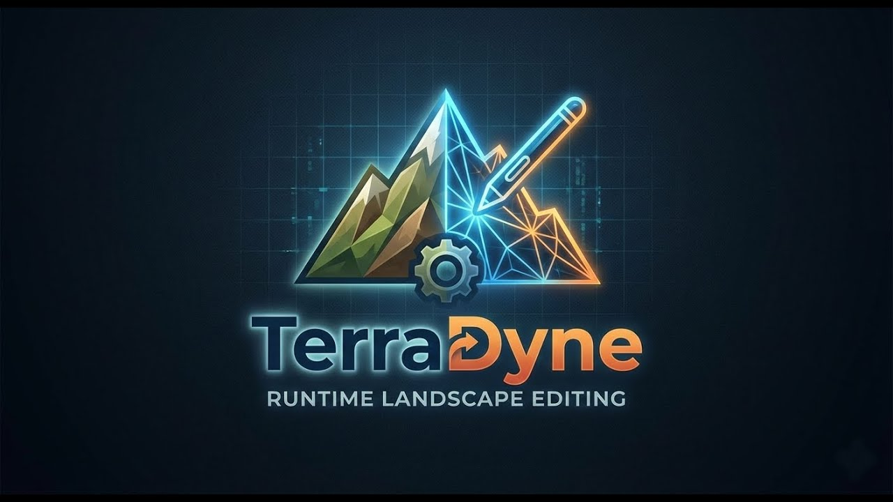
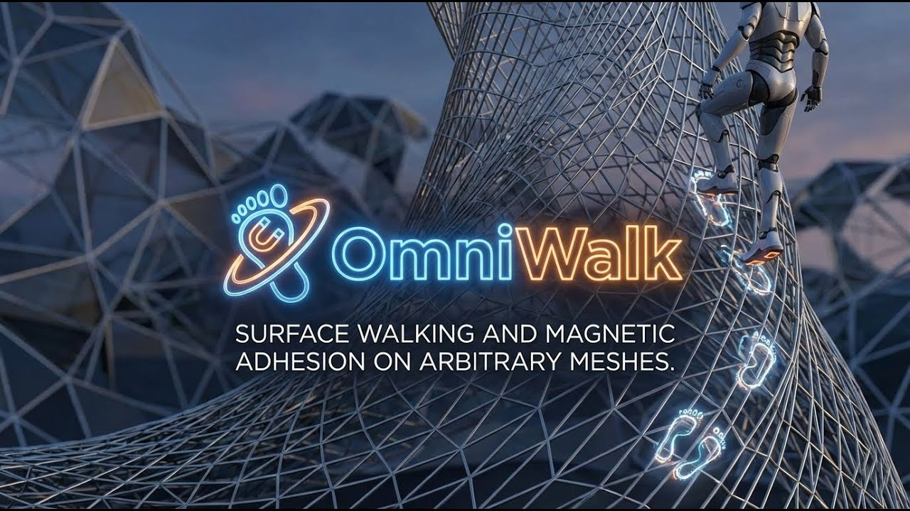
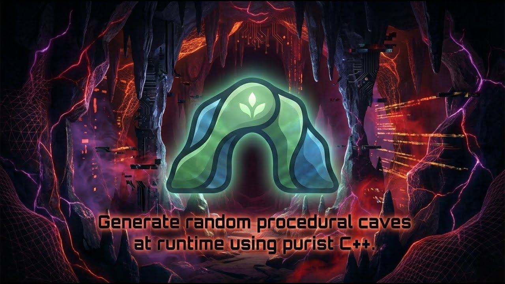
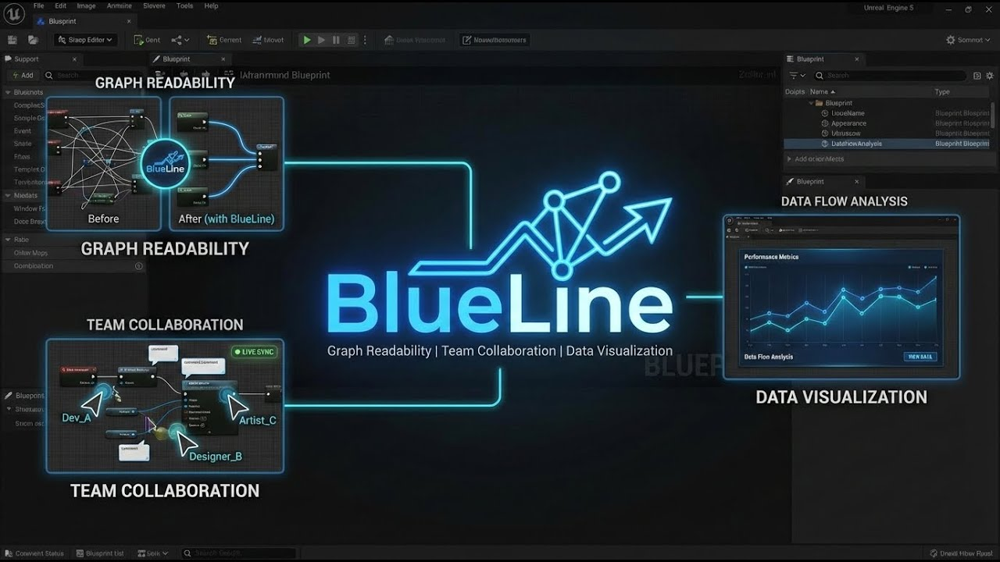
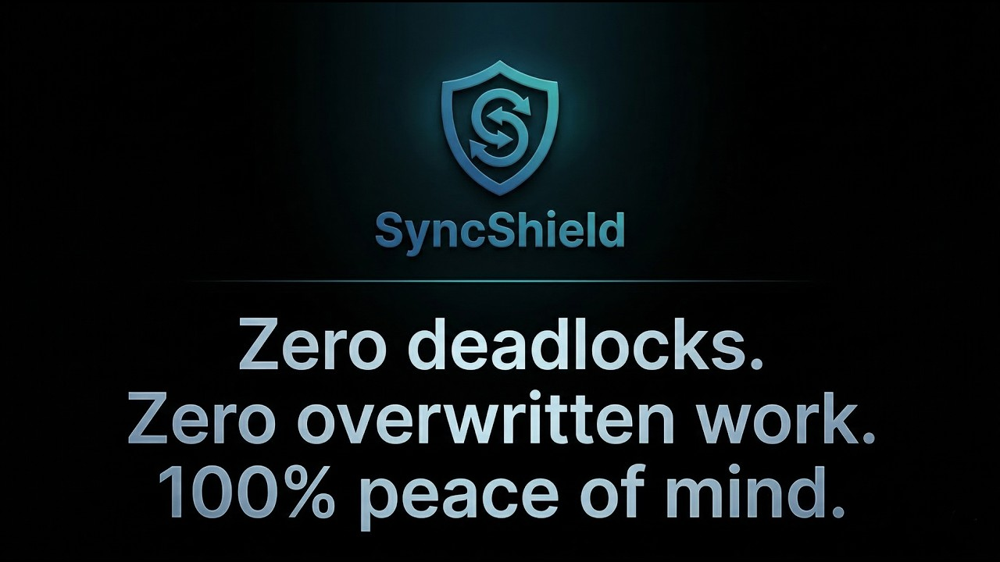

# Andras Gregori @ GregOrigin

**Unreal Engine C++ engineer. I fix UE5 stutter and get Unreal Android games through Google Play.**

---

### 🛠️ What I do for studios

Fixed-price work inside your project. You get a written report and before/after proof.

- **Google Play Compliance Pass (UE 5.5–5.8):** target API 36, Play Billing Library 8 and 16 KB memory pages, plus a preflight report of everything Play would reject. Google's extension window for API 36 ends on **1 November 2026**.
- **Stutter & First-Run Fix (UE5 PC / Steam):** a cold-cache hitch capture, the whole PSO pipeline (collection, bundling, precaching, warm-up) and scalability defaults for mainstream PCs.
- **Contract Unreal C++:** plugins, editor tools, build and packaging pipelines, and gameplay systems.

**➡️ [Prices and a free 20-minute check: gregorigin.com](https://gregorigin.com)**

---

### 🚀 The proof: my systems

Several of these repos are the free Core versions of my [Fab plugins](https://www.fab.com/sellers/GregOrigin).

<table align="center">
  <tr>
    <td width="50%" align="center">
      
       
      <b>PSO Autopilot</b>
       
      <i>Memory-safe, asynchronous PSO cache collection and warm-up with time-sliced Game Thread yielding. The engine work behind the stutter fix.</i>
       
      
    </td>
    <td width="50%" align="center">
      
       
      <b>TargetFrame</b>
       
      <i>Dynamic runtime scalability that holds frame rate on mainstream PCs, so Lumen doesn't sink your first-run experience.</i>
       
      
    </td>
  </tr>
  <tr>
    <td width="50%" align="center">
      
       
      <b>TerraDyne</b>
       
      <i>Native C++ runtime landscape: real-time sculpting, digging, painting and persistence.</i>
       
      
    </td>
    <td width="50%" align="center">
      
       
      <b>Rollback Core</b>
       
      <i>Deterministic GGPO-style rollback netcode for UE5: fixed-step simulation, save/restore and resimulation.</i>
       
      
    </td>
  </tr>
  <tr>
    <td width="50%" align="center">
      
       
      <b>OmniWalk</b>
       
      <i>Zero-config arbitrary gravity and surface adhesion. Native C++ "Magneboot" locomotion for spider-walking and planetary gravity.</i>
       
      
    </td>
    <td width="50%" align="center">
      
       
      <b>Instant Organic Caves (IOC)</b>
       
      <i>Lightweight, purist C++ engine that generates procedural caves and rock structures at runtime.</i>
       
      
    </td>
  </tr>
  <tr>
    <td width="50%" align="center">
      
       
      <b>BlueLine Core</b>
       
      <i>Blueprint UX toolkit: algorithmic wire-crossing minimisation, linting and semantic auto-tagging.</i>
       
      
    </td>
    <td width="50%" align="center">
      
       
      <b>SyncShield / SafeSave</b>
       
      <i>A source-control safety net for Git, Plastic and Perforce. It catches dirty packages and enforces file locks before they turn into merge conflicts.</i>
       
      
    </td>
  </tr>
</table>

---

### ⚙️ Technical Stack & Experience

*   **Languages:** `C++20`, `HLSL/GLSL`, `C#`, `Python`, `TypeScript`, `PHP`
*   **Game Engine:** `Unreal Engine 5.4 - 5.8` (source builds, UBT, UAT, plugin architecture)
*   **Shipping:** multi-engine packaging and automated test matrices (UE 5.5–5.8), Android toolchain (SDK/NDK, Gradle, UPL), Google Play requirements
*   **Core Systems:**
    *   Asynchronous multithreading (TaskGraph, FMonitoredProcess)
    *   Dynamic/procedural mesh generation (UDynamicMeshComponent, voxels)
    *   Custom locomotion and physics solvers that skip the overhead of the standard Character Movement Component
    *   Editor utilities, Slate UI and engine-level hooking
*   **Graphics/Rendering:** shader pipeline caching (PSO), compute shaders, Runtime Virtual Textures (RVT)

Also: native Windows 11 tools on [itch.io](https://gregorigin.itch.io/) · support the free Core versions on [Patreon](https://www.patreon.com/gregorigin) · all links on [Linktree](https://linktr.ee/agregori)

 

  

